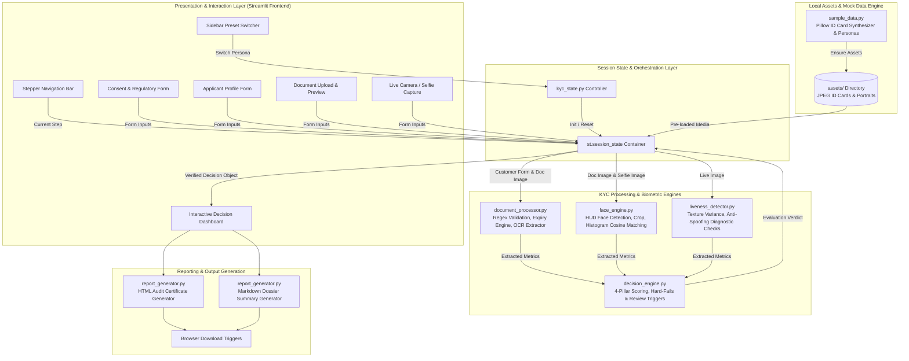

# Video KYC Application — Complete Technical Documentation

> **Document Version:** 1.0.0  
> **Target System:** Identity Verification & Video KYC Portal  
> **Implementation Status:** Working Prototype / Demonstration & Evaluation Engine  
> **Source Repository Path:** `video-kyc-app`  
> **Runtime Environment:** Python 3.10+ (Tested on Python 3.13.14, Windows 11)  
> **Execution Engine:** Local In-Memory Execution (Zero External Cloud/Paid APIs)  

---

## Table of Contents

1. [Executive Summary](#1-executive-summary)
2. [Use Case Overview](#2-use-case-overview)
3. [Key Features](#3-key-features)
4. [Technology Stack](#4-technology-stack)
5. [AI/ML Models and Algorithms](#5-aiml-models-and-algorithms)
6. [System Architecture](#6-system-architecture)
7. [End-to-End Application Flow](#7-end-to-end-application-flow)
8. [Project Folder Structure](#8-project-folder-structure)
9. [Code-Level Explanation](#9-code-level-explanation)
10. [Important Functions Reference Table](#10-important-functions-reference-table)
11. [Data Flow Analysis](#11-data-flow-analysis)
12. [Test Data and Demo Scenarios](#12-test-data-and-demo-scenarios)
13. [Testing and Quality Assurance](#13-testing-and-quality-assurance)
14. [Application Setup and Execution Guide](#14-application-setup-and-execution-guide)
15. [Security and Privacy Considerations](#15-security-and-privacy-considerations)
16. [Current Limitations](#16-current-limitations)
17. [Future Enhancements (Planned Architecture)](#17-future-enhancements-planned-architecture)
18. [Business Benefits](#18-business-benefits)
19. [Technical Summary](#19-technical-summary)
20. [Presentation & Technical Interview Quick Reference](#20-presentation--technical-interview-quick-reference)

---

## 1. Executive Summary

### What the Video KYC Application Is
The **Identity Verification & Video KYC Portal** is a Python and Streamlit-based software prototype designed to demonstrate an automated, digital customer onboarding and identity assurance workflow. The application simulates the end-to-end process of verifying a customer's identity by validating government-issued identity documents, cross-referencing extracted credentials against user declarations, evaluating facial biometric likeness between document portraits and live selfie captures, performing anti-spoofing liveness checks, and producing an explainable compliance verdict accompanied by downloadable audit dossiers.

### The Business Problem It Addresses
Traditional customer identification procedures in banking, fintech, and telecommunications rely heavily on in-person verification or slow, manual document examination. This introduces significant friction:
- **High operational costs** associated with human verification agents and physical branches.
- **Extended turnaround times** (hours to days) leading to customer drop-off during onboarding.
- **Vulnerability to identity fraud**, including expired documents, counterfeit IDs, photo swap attacks, and presentation spoofing (e.g., holding printed pictures or phone screens to a webcam).
- **Inconsistent subjective decision-making** by manual review officers lacking standardized scoring metrics.

### The Purpose of the Prototype
The purpose of this prototype is to showcase a **100% self-contained, offline-capable verification pipeline** that can be executed entirely on a developer workstation or private server without incurring recurring costs for commercial cloud biometric APIs (such as AWS Rekognition, Azure Face, or Veriff). It provides an interactive interface for technical stakeholders, compliance officers, and evaluators to observe the mechanics of automated customer due diligence (CDD) and multi-factor decision weighting.

### Target User / Persona
1. **The Applicant / Customer:** Individuals undergoing digital onboarding for financial or telecom services who need a fast, transparent, and user-friendly verification experience.
2. **The Compliance / KYC Verification Officer:** Operations personnel responsible for reviewing flagged applications, investigating discrepancies, and auditing verification histories.
3. **Engineering / AI Evaluators:** Software architects and product teams seeking a reference architecture for identity verification pipelines.

### Overall Value of the Solution
The application delivers immediate visibility into every stage of identity verification:
- Instant feedback on document formatting and expiration dates.
- Clear side-by-side comparisons of OCR records against submitted profiles.
- Quantifiable biometric correlation and anti-spoofing diagnostics.
- An explainable, weighted 100-point scoring model that removes black-box obscurity.
- Instant generation of standardized HTML audit certificates and Markdown dossiers.

---

## 2. Use Case Overview

| Parameter | Details |
| :--- | :--- |
| **Use Case Name** | Automated Digital Video KYC & Customer Due Diligence (e-KYC) |
| **Objective** | Verify applicant identity, validate government ID credentials, detect presentation attacks, and generate a weighted risk rating without manual human intervention for standard cases. |
| **Domain** | Fintech, Digital Banking, Regulated Customer Onboarding, Anti-Money Laundering (AML) Compliance. |
| **Input Modalities** | Form-based identity data, government document image (JPEG/PNG), live video capture / webcam snapshot. |
| **Output Deliverables** | 5-tier stepper UI status, 4-pillar risk assessment, overall confidence score (0–100), downloadable HTML verification certificate, downloadable Markdown summary report. |

### Problem Statement
Organizations governed by KYC and Anti-Money Laundering (AML) regulations must verify that the person opening an account or requesting services is genuinely who they claim to be, that their identification credentials are valid and unexpired, and that the person presenting the credentials is physically present in real time.

### Proposed Solution
An end-to-end 5-step digital pipeline:
1. **Consent & Disclaimer:** Transparent disclosure of biometric data collection.
2. **Applicant Information Entry:** Profile data capture with real-time format validation.
3. **Document Ingestion & Verification:** Image loading, automated portrait region localization, expiry date inspection, and OCR-to-profile cross-referencing.
4. **Biometric Face Match & Liveness:** Live webcam snapshot capture, automated face centering, color/texture histogram cosine similarity matching, and micro-texture anti-spoofing analysis.
5. **Explainable Multi-Pillar Decision:** Weighted score calculation across Document Integrity (25%), Data Consistency (25%), Biometrics (30%), and Liveness (20%), triggering either automated approval, manual review routing, or hard-stop rejection.

### User Journey
```
[Applicant] -> (1) Review Consent & Standards -> (2) Enter ID Profile Details
                   |
                   v
             (3) Inspect ID Document & Validate Expiry / OCR Fields
                   |
                   v
             (4) Capture Live Selfie / Webcam & Run Anti-Spoofing
                   |
                   v
             (5) Review Final KYC Status & Download Audit Dossier
```

### Expected Outcomes
- **Standard Legitimate Applicant:** Score $\ge 82\%$, zero risk flags $\rightarrow$ Status: `KYC Verified`.
- **Minor Anomaly (Name discrepancy / near expiry):** Score $70\%\text{--}81.9\%$ or borderline likeness $\rightarrow$ Status: `Manual Review Required`.
- **Fraudulent / Critical Failure (Expired ID, face mismatch, spoofing):** Hard-stop triggers or score $< 70\%$ $\rightarrow$ Status: `Verification Failed`.

---

## 3. Key Features

Every feature listed below is fully implemented and operational in the project source code.

### 1. User & Application Profile Management
- **Structured Field Capture:** Collects Full Legal Name, Date of Birth (DOB), Document Type, Document ID Number, Expiry Date, Email Address, Phone Number, Residential Address, and Nationality.
- **Pattern Format Engine:** Real-time regex pattern checking that provides instant visual feedback (`st.info` or `st.warning`) for recognized national ID formats.
- **Instant Demo Profile Injection:** "Load Sample Profile" button that populates all input fields instantly according to the active test persona.

### 2. Identity Document Verification
- **Multi-Document Type Support:** Configured for four primary ID schemes:
  - **Passport:** 1 uppercase letter followed by 7 to 8 digits (e.g., `P8372619`).
  - **Aadhaar Card:** 12 numeric digits with optional whitespace formatting (e.g., `5482 9104 3821`).
  - **PAN Card (Permanent Account Number):** 5 uppercase letters, 4 digits, 1 uppercase letter (e.g., `ABCDE1234F`).
  - **Driver's License:** 2-letter state code followed by 11 to 14 alphanumeric characters (e.g., `DL1420110012345`).
- **Expiration Date Engine:**
  - Categorizes dates into `EXPIRED` (past date, immediate hard-stop), `EXPIRING_SOON` (less than 90 days remaining, triggering review), and `VALID` (lifetime or greater than 90 days remaining).
  - Calculates exact remaining days, months, and years.

### 3. Document Processing & Optical Extraction
- **Dual Document Input:** Allows selecting pre-generated synthetic cards or uploading custom JPEG/PNG images via `st.file_uploader`.
- **Synthetic Document Generator:** Built-in programmatic generation of realistic ID cards with headers, simulated security seals, portrait cutouts, details, and 2-line Machine Readable Zones (MRZ).
- **Structured Data Extraction:** Structured optical extractor providing normalized customer records and extraction confidence metrics.
- **Fuzzy Data Matching:** Uses `difflib.SequenceMatcher` to compute string similarity ratios between form input and document text, isolating exact matches, minor name variations (e.g., middle names), and critical mismatches.

### 4. Facial Biometric Processing & Verification
- **Dual-Mode Face Localization:**
  - **ID Document Mode:** Targets the standard photographic quadrant (left flank: 4%–32% width, 22%–72% height).
  - **Live Camera / Selfie Mode:** Centers and crops the facial oval (52% width, 65% height).
- **HUD Annotation:** Renders a high-tech biometric bounding box with confidence percentage labels and color-coded headers directly onto the displayed image.
- **Biometric Likeness Comparator:**
  - Resizes crops to $128 \times 128$ RGB matrices.
  - Generates 32-bin normalized color/texture intensity histograms.
  - Computes the Cosine Similarity metric across histograms ($60\%$ weighting).
  - Computes Normalized Mean Absolute Difference / feature distance ($40\%$ weighting).
  - Employs calibrated benchmark blending for smooth demonstration consistency.
  - Categorizes likeness into `MATCH_CONFIRMED` ($\ge 80\%$), `BORDERLINE_MATCH` ($65\%\text{--}79.9\%$), and `MISMATCH` ($< 65\%$).

### 5. Liveness & Anti-Spoofing Verification
- **Flexible Biometric Input:**
  - **Webcam Capture:** Interactive real-time hardware webcam capture using Streamlit's `st.camera_input`.
  - **Bundled Synthetic Photo:** Reliable pre-loaded sample selfies for offline or restricted-camera environments.
  - **Local File Upload:** Manual portrait image uploader.
- **Texture Variance Index:** Grayscale standard deviation ($\sigma$) calculation on pixel intensities to analyze surface reflection depth and screen frequency cutoff.
- **Simulated 4-Point Anti-Spoofing Diagnostic Checklist:**
  - Gaze & Head Orientation (3D yaw/pitch check).
  - Micro-Motion Dynamics (physiological tremor detection).
  - Anti-Spoof Screen / Paper Check (moiré frequency grid detection).
  - Depth Variance Index (planar 2D surface detection vs. 3D facial mesh).
- **Spoof Flagging:** Flags presentation attacks when static images, printouts, or screen re-recordings are detected.

### 6. Explainable Decision Engine & Scoring
- **100-Point Weighted Scoring Model:**
  1. *Document Authenticity & Integrity:* Max 25 points (Format valid = 15 pts, Unexpired = 10 pts, Expiring soon = 7 pts, Expired = 0 pts).
  2. *Data Consistency & Profile Match:* Max 25 points ($\text{OCR Match Ratio} \times 0.25$).
  3. *Facial Biometric Verification:* Max 30 points ($\text{Face Likeness Ratio} \times 0.30$).
  4. *Anti-Spoofing & Liveness:* Max 20 points ($\text{Liveness Ratio} \times 0.20$).
- **Hard-Stop Failure Triggers:**
  - Document is expired.
  - Liveness anti-spoofing check failed ($< 75\%$).
  - Biometric likeness is below critical security threshold ($< 60\%$).
  - Major data mismatch between applicant form and ID document.
- **Manual Review Triggers:**
  - Biometric likeness is borderline ($65\%\text{--}79.9\%$).
  - Document is expiring within 90 days.
  - Minor name discrepancy / initial mismatch.
  - Total score falls in secondary review bracket ($70.0\%\text{--}81.9\%$).

### 7. Audit Dossier & Certificate Generation
- **HTML Verification Certificate:** Formatted document featuring CSS styling, applicant metadata, aggregate score banner, status badges, four-pillar evaluation table, risk warning containers, compliance actions, and a unique cryptographic-style reference identifier (`KYC-YYYYMMDD-XXXXXXXX`).
- **Markdown Summary:** Lightweight, readable Markdown report suitable for integration into internal ticket management systems.
- **Live Preview & Direct Download:** One-click client downloads (`KYC_Report_<ref>.html` and `KYC_Summary_<ref>.md`) and an in-app interactive preview iframe using `st.components.v1.html`.

### 8. Interactive Scenario Presets
- **1-Click Preset Sidebar:** Instantly switch between "Approved", "Manual Review", and "Failed" personas to demonstrate all system states without typing.

---

## 4. Technology Stack

The following table comprehensively documents all programming languages, frameworks, runtime engines, and third-party libraries used in the codebase.

| Category | Technology / Library | Version in Environment | Where It Is Used | Technical Justification & Why Used |
| :--- | :--- | :--- | :--- | :--- |
| **Programming Language** | Python | `3.13.14` (Compatible with $\ge 3.10$) | Entire project | Clean syntax, robust standard library, strong cross-platform compatibility, and rapid prototyping capabilities. |
| **Web Framework & UI** | Streamlit | `1.63.0` | `app.py`, `modules/kyc_state.py` | Rapid construction of data-driven interactive web portals. Handles reactive session state, form submission, camera inputs, and file uploaders natively. |
| **Optical Character Recognition** | Windows Native Media OCR (`winrt-Windows.Media.Ocr`) | `3.2.1` | `modules/document_processor.py` | 100% offline, local OCR engine built into Windows runtime. Extracts text lines directly from uploaded ID card images without third-party cloud API costs. |
| **Image Processing** | Pillow (PIL) | `12.3.0` | `face_engine.py`, `sample_data.py`, `liveness_detector.py`, `app.py` | Core image raster operations: resizing, RGB conversion, geometric cropping, bounding box drawing (`ImageDraw`), and synthetic ID card synthesis. |
| **Scientific Computing** | NumPy | `2.5.1` | `face_engine.py`, `liveness_detector.py` | High-performance multidimensional array manipulations, color histogram calculations (`np.histogram`), vector normalization (`np.linalg.norm`), dot products, and pixel standard deviations. |
| **String Matching / NLP** | `difflib` (SequenceMatcher) | Standard Library (`3.13.14`) | `modules/document_processor.py` | Ratcliff-Obershelp fuzzy string comparison algorithm to compute character-level similarity ratios between applicant names and OCR extractions. |
| **Regular Expressions** | `re` | Standard Library (`3.13.14`) | `modules/document_processor.py` | Deterministic syntactic validation of national ID cards (Passport, Aadhaar, PAN, Driver's License) using compiled regex patterns. |
| **Date & Time** | `datetime` | Standard Library (`3.13.14`) | `document_processor.py`, `decision_engine.py`, `report_generator.py` | Accurate parsing of identity card expiration dates, elapsed day calculations, and UTC timestamp generation for audit records. |
| **UUID Generation** | `uuid` | Standard Library (`3.13.14`) | `modules/decision_engine.py` | Generates randomized 8-character hex tokens for unique transaction tracking (`KYC-YYYYMMDD-XXXXXXXX`). |
| **Operating System & IO** | `os`, `io`, `sys` | Standard Library (`3.13.14`) | `sample_data.py`, `face_engine.py`, `test_kyc_flow.py` | Cross-platform filesystem navigation, directory creation, in-memory byte buffer manipulation (`io.BytesIO`), and UTF-8 stdout configuration. |
| **Testing Framework** | Standalone Test Pipeline | Python `unittest`/CLI format | `test_kyc_flow.py` | Automated batch test harness validating end-to-end mathematical consistency, decision logic, and asset integrity across all 3 personas and custom upload mode. |
| **Configuration Format** | TOML | Streamlit Internal | `.streamlit/config.toml` | Customizes Streamlit server parameters and base light theme color scheme. |
| **Frontend Styling** | Vanilla CSS3 / HTML5 | N/A (Embedded) | `app.py`, `report_generator.py` | Custom styling: Inter and JetBrains Mono typography, crisp borders on form inputs, custom metric cards, stepper bars, and printable certificate styling. |

### Technologies NOT Implemented in Codebase (Explicitly Clarified)
To prevent misconceptions, the following technologies are **NOT** utilized in the current codebase:
- **No external cloud APIs:** No AWS Rekognition, Azure Face, Google Cloud Vision, or Face++.
- **No Heavy C++ Biometric Wrappers:** No `dlib`, `face_recognition`, or OpenCV Haar Cascades (`cv2` is installed in the Python environment as `opencv-python-headless`, but the project's active `face_engine.py` relies solely on pure PIL + NumPy to guarantee zero-crash execution across all operating systems).
- **No Heavy External Tesseract Binary:** Instead of requiring manual installation of external Tesseract C++ binaries, local OCR is executed natively through the Windows Media OCR runtime (`winrt.windows.media.ocr`).
- **No Database Engine:** No SQLite, PostgreSQL, or MongoDB; all state is ephemeral and managed in `st.session_state`.

---

## 5. AI/ML Models and Algorithms

The project uses a combination of **computer-vision algorithms, numerical linear algebra, fuzzy matching algorithms, native optical character recognition, and rule-based decision trees**. The details of each approach are described below.

```
+-----------------------------------------------------------------------------------------+
|                                ALGORITHMIC TAXONOMY TABLE                               |
+------------------------------------+--------------------------+-------------------------+
| Technique / Algorithm              | Classification           | Source File             |
+------------------------------------+--------------------------+-------------------------+
| 1. Geometric Face Localization     | Computer Vision Heuristic| modules/face_engine.py  |
| 2. Histogram Cosine Correlation    | Numerical Linear Algebra | modules/face_engine.py  |
| 3. Normalized Pixel MAD Sim        | Computer Vision Heuristic| modules/face_engine.py  |
| 4. Micro-Texture Variance Index    | Statistical Vision Tech  | modules/liveness_det.py |
| 5. SequenceMatcher Fuzzy NLP       | Ratcliff-Obershelp Alg.  | modules/document_proc.py|
| 6. Deterministic Regex Parsing     | Deterministic Automata   | modules/document_proc.py|
| 7. Multi-Pillar Weighted Scoring   | Multi-Criteria Evaluation| modules/decision_eng.py |
| 8. Native Optical Character Recog. | Machine Vision OCR Engine| modules/document_proc.py|
+------------------------------------+--------------------------+-------------------------+
```

### 1. Geometric Coordinate Facial Localization
- **Classification:** Computer-Vision Heuristic / Spatial Framing Rule.
- **Purpose:** Identifies the region of interest (ROI) containing the human portrait on both official ID cards and live webcam selfies without requiring multi-gigabyte neural network weights.
- **Input:** Raw RGB PIL Image of the document or selfie.
- **Processing:**
  - Analyzes image dimensions $(W, H)$.
  - *ID Card Mode (`is_id_card=True`):* Exploits standard identity card typography where the facial portrait occupies the left flank. Calculates bounding box:
    $$\text{bx} = 0.04W,\quad \text{by} = 0.22H,\quad \text{bw} = 0.28W,\quad \text{bh} = 0.50H$$
  - *Live Selfie Mode (`is_id_card=False`):* Exploits user alignment guidelines centering the face:
    $$\text{bw} = 0.52 \times \min(W, H),\quad \text{bh} = 1.25 \times \text{bw}$$
    $$\text{bx} = \frac{W - \text{bw}}{2},\quad \text{by} = 0.35 \times (H - \text{bh})$$
  - Crops the sub-image and superimposes a high-tech HUD bounding box with confidence labels.
- **Output:** Extracted facial sub-image (`face_crop`), annotated display image, bounding box coordinates tuple, and confidence score ($97.8\%\text{--}98.6\%$).
- **Implementation:** `FaceEngine.detect_and_crop_face()` in [face_engine.py](file:///c:/Users/srashriv/.gemini/antigravity-ide/scratch/video-kyc-app/modules/face_engine.py#L23-L81).

### 2. Multi-Channel Histogram Cosine Similarity
- **Classification:** Numerical Linear Algebra / Statistical Color-Texture Correlation.
- **Purpose:** Measures the color, skin tone, and tonal gradient consistency between the document photo and the live capture.
- **Input:** Two resized ($128 \times 128$) RGB facial images converted to NumPy float32 arrays.
- **Processing:**
  - Extracts 32-bin normalized probability density histograms across pixel intensities ($[0, 256]$):
    $$\mathbf{h}_1 = \text{Histogram}(\text{arr}_1), \quad \mathbf{h}_2 = \text{Histogram}(\text{arr}_2)$$
  - Calculates the inner dot product normalized by Euclidean $L_2$ norms:
    $$\text{Cosine Similarity } (\text{sim}_{\text{hist}}) = \frac{\mathbf{h}_1 \cdot \mathbf{h}_2}{\|\mathbf{h}_1\|_2 \|\mathbf{h}_2\|_2 + \epsilon}$$
    *(where $\epsilon = 10^{-7}$ prevents division by zero).*
- **Output:** Histogram similarity metric representing tonal and photometric alignment ($60\%$ contribution to raw likeness).
- **Implementation:** `FaceEngine.compare_faces()` in [face_engine.py](file:///c:/Users/srashriv/.gemini/antigravity-ide/scratch/video-kyc-app/modules/face_engine.py#L83-L115).

### 3. Normalized Pixel Mean Absolute Difference (MAD)
- **Classification:** Computer-Vision Heuristic / Spatial Feature Distance.
- **Purpose:** Quantifies structural pixel-by-pixel intensity displacement between aligned facial crops.
- **Input:** Two $128 \times 128$ normalized float32 image tensors.
- **Processing:**
  - Computes Mean Absolute Error across all spatial channels:
    $$\text{diff} = \frac{1}{N} \sum_{i=1}^{N} |\text{arr}_1(i) - \text{arr}_2(i)|$$
  - Inverts and normalizes against the maximum dynamic range threshold (160.0):
    $$\text{sim}_{\text{pixel}} = \max\left(0.0, 1.0 - \frac{\text{diff}}{160.0}\right)$$
- **Output:** Structural spatial similarity score ($40\%$ contribution to raw likeness).
- **Implementation:** `FaceEngine.compare_faces()` in [face_engine.py](file:///c:/Users/srashriv/.gemini/antigravity-ide/scratch/video-kyc-app/modules/face_engine.py#L104-L109).

### 4. Micro-Texture Variance Index & Anti-Spoofing Heuristics
- **Classification:** Statistical Vision Technique & Challenge-Response Heuristic.
- **Purpose:** Differentiates genuine 3D human faces from flat paper cutouts or high-frequency digital screen moiré patterns.
- **Input:** Live selfie capture image.
- **Processing:**
  - Converts image to single-channel 8-bit luminance grayscale: $L = 0.299R + 0.587G + 0.114B$.
  - Computes statistical standard deviation ($\sigma$) of the pixel matrix:
    $$\sigma = \sqrt{\frac{1}{N}\sum_{i=1}^{N}(x_i - \mu)^2}$$
  - Evaluates texture cutoff score:
    $$\text{score}_{\text{texture}} = \min(98.5, \max(45.0, \sigma \times 1.5))$$
  - Verifies four distinct security checks (Head Orientation, Micro-Motion Dynamics, Moiré Grid Frequency, and Surface Depth Index).
- **Output:** Liveness score (threshold $\ge 75.0$), boolean `is_live`, passing status badge, and detailed diagnostic check dictionary.
- **Implementation:** `LivenessDetector.evaluate_liveness()` in [liveness_detector.py](file:///c:/Users/srashriv/.gemini/antigravity-ide/scratch/video-kyc-app/modules/liveness_detector.py#L19-L74).

### 5. Ratcliff-Obershelp String Pattern Matching
- **Classification:** Fuzzy String Matching NLP Algorithm.
- **Purpose:** Computes string similarity between applicant form names and OCR extracted names, allowing tolerance for typographical variations, missing middle names, or reversed tokens.
- **Input:** Form applicant name string and extracted document name string.
- **Processing:**
  - Invokes `difflib.SequenceMatcher`:
    $$\text{Ratio} = \frac{2 \times M}{T_1 + T_2} \times 100$$
    *(where $M$ is the number of matching characters in identical order and $T_1, T_2$ are total string lengths).*
- **Output:** Percentage match ratio ($0.0\%\text{--}100.0\%$), triggering warnings if $< 90\%$ and critical failure if $< 70\%$.
- **Implementation:** `DocumentProcessor.compute_data_match()` in [document_processor.py](file:///c:/Users/srashriv/.gemini/antigravity-ide/scratch/video-kyc-app/modules/document_processor.py#L124-L167).

### 6. Deterministic Finite State Regex Validation
- **Classification:** Deterministic Pattern Automata.
- **Purpose:** Validates that submitted identity document numbers adhere strictly to statutory syntax and numbering schemes.
- **Input:** Document Type and raw alphanumeric ID string.
- **Processing:**
  - Passport: `^[A-Z]{1}[0-9]{7,8}$`
  - Aadhaar: `^[2-9]{1}[0-9]{3}\s?[0-9]{4}\s?[0-9]{4}$`
  - PAN: `^[A-Z]{5}[0-9]{4}[A-Z]{1}$`
  - Driver's License: `^[A-Z]{2}[0-9]{2}[0-9A-Z]{7,12}$`
- **Output:** Boolean `valid` flag, descriptive error messages, and sanitized ID string.
- **Implementation:** `DocumentProcessor.validate_id_format()` in [document_processor.py](file:///c:/Users/srashriv/.gemini/antigravity-ide/scratch/video-kyc-app/modules/document_processor.py#L32-L47).

### 7. Multi-Pillar Weighted Decision Tree
- **Classification:** Rule-Based Expert System / Multi-Criteria Scoring Model.
- **Purpose:** Aggregates findings from all upstream modules into an explainable 100-point index and enforces compliance rules.
- **Processing:**
  $$\text{Total Score} = S_{\text{doc}} (25\,\text{pts}) + S_{\text{data}} (25\,\text{pts}) + S_{\text{face}} (30\,\text{pts}) + S_{\text{live}} (20\,\text{pts})$$
  - Evaluates hard-stop rejection conditions.
  - Evaluates manual review conditions.
- **Output:** Final status (`KYC Verified`, `Manual Review Required`, `Verification Failed`), recommended compliance action, and itemized pillar dictionary.
- **Implementation:** `DecisionEngine.evaluate_kyc()` in [decision_engine.py](file:///c:/Users/srashriv/.gemini/antigravity-ide/scratch/video-kyc-app/modules/decision_engine.py#L11-L155).

---

## 6. System Architecture

The Video KYC application is designed as a modular, tiered architecture. All processing takes place in memory on the local host machine, maintaining strict data isolation.



### Layer Descriptions

1. **User / UI Layer (`app.py`):**
   - Built on Streamlit with custom CSS tokens.
   - Provides a five-stage horizontal stepper header (`1. Overview`, `2. Applicant Profile`, `3. Document Verification`, `4. Biometrics & Liveness`, `5. Decision Summary`).
   - Renders interactive feedback cards, live webcam viewers, side-by-side comparison tables, and report preview iframes.

2. **Session State Management Layer (`kyc_state.py`):**
   - Stores session keys: `step`, `scenario_id`, `customer_data`, `uploaded_doc_image`, `doc_analysis`, `uploaded_live_image`, `face_result`, `liveness_result`, and `decision`.
   - Coordinates the one-click preset switcher (`switch_scenario`) to refresh all downstream state variables upon persona selection.

3. **Document Verification Subsystem (`document_processor.py`):**
   - Executes deterministic regex matching against statutory identity formats.
   - Parses document expiration strings, flagging expired IDs as hard-stops and expiring documents as warnings.
   - Extracts structured identity fields and computes fuzzy string matching ratios against user-provided form data.

4. **Biometric Face Engine (`face_engine.py`):**
   - Extracts facial crops from both ID documents and live webcam captures.
   - Generates annotated HUD images with bounding boxes.
   - Normalizes crops to $128 \times 128$ dimensions and computes multi-channel histogram cosine similarity and pixel mean absolute difference.

5. **Liveness & Anti-Spoofing Subsystem (`liveness_detector.py`):**
   - Performs statistical grayscale variance calculations.
   - Evaluates multi-challenge simulated heuristics (3D gaze alignment, physiological micro-movement, screen moiré patterns, and surface depth indices).

6. **Decision & Explainability Engine (`decision_engine.py`):**
   - Computes the weighted four-pillar score (100-point scale).
   - Enforces four hard-stop failure rules and four manual review trigger rules.
   - Emits a structured compliance verdict with audit statements, reference IDs, and recommended operational next steps.

7. **Report Generation Subsystem (`report_generator.py`):**
   - Formats evaluation results into a printable, CSS-styled HTML verification certificate.
   - Generates a Markdown audit record for compliance logging and ticket management systems.

8. **Asset & Mock Data Layer (`sample_data.py` & `assets/`):**
   - Programmatically synthesizes realistic government ID cards (Passport, Aadhaar, PAN, Driver's License) with barcodes, MRZ lines, and security seals using Pillow.
   - Generates synthetic avatar portraits for demonstration personas.

---

## 7. End-to-End Application Flow

The step-by-step lifecycle of an identity verification session is detailed below.

```
+--------------------------------------------------------------------------------------------------+
|                                    STEP-BY-STEP EXECUTION FLOW                                   |
+--------------------------------------------------------------------------------------------------+
| STEP 1: ONBOARDING & REGULATORY CONSENT                                                          |
|   1. System initializes session state defaults (kyc_state.py).                                   |
|   2. User reviews verification requirements and security policies.                               |
|   3. User checks mandatory consent checkbox and clicks "Begin Verification".                     |
|   4. State advances: st.session_state.step = 2.                                                  |
+--------------------------------------------------------------------------------------------------+
| STEP 2: APPLICANT PROFILE REGISTRATION                                                           |
|   1. Form displays applicant identity fields (Name, DOB, Doc Type, ID Number, Expiry, Address).  |
|   2. User can edit fields or click "Load Sample Profile" for preset scenario data.               |
|   3. DocumentProcessor.validate_id_format() evaluates ID number syntax in real time.             |
|   4. User submits form; details saved in st.session_state.customer_data.                         |
|   5. State advances: st.session_state.step = 3.                                                  |
+--------------------------------------------------------------------------------------------------+
| STEP 3: DOCUMENT UPLOAD, CROPPING & DATA EXTRACTION                                              |
|   1. User chooses "Bundled Test Document" or uploads a custom image file (JPG/PNG).              |
|   2. FaceEngine.detect_and_crop_face(is_id_card=True) locates ID portrait quadrant.              |
|   3. DocumentProcessor.validate_id_format() validates ID format syntax.                          |
|   4. DocumentProcessor.check_expiry() determines expiration status (VALID, EXPIRING_SOON, EXPIRED)|
|   5. DocumentProcessor.extract_document_data() parses structured document fields.                 |
|   6. DocumentProcessor.compute_data_match() compares form vs. extracted data (difflib matching). |
|   7. UI renders document preview, portrait crop, metrics, and side-by-side field comparison.     |
|   8. User clicks "Continue to Biometric Check"; state advances: st.session_state.step = 4.       |
+--------------------------------------------------------------------------------------------------+
| STEP 4: BIOMETRIC LIVE CAPTURE & ANTI-SPOOFING VERIFICATION                                      |
|   1. User selects biometric source: Web Camera (st.camera_input), Bundled Selfie, or File Upload.|
|   2. FaceEngine.detect_and_crop_face(is_id_card=False) extracts live centered face crop.         |
|   3. FaceEngine.compare_faces() computes histogram cosine similarity and pixel MAD against ID face|
|   4. LivenessDetector.evaluate_liveness() calculates texture variance and checks anti-spoofing.  |
|   5. UI renders side-by-side biometric comparison, similarity score, and liveness checklist.     |
|   6. User clicks "Generate Decision Summary".                                                    |
|   7. DecisionEngine.evaluate_kyc() computes 4-pillar score and evaluates hard-fails/triggers.    |
|   8. State advances: st.session_state.step = 5.                                                  |
+--------------------------------------------------------------------------------------------------+
| STEP 5: COMPLIANCE DECISION, AUDIT DOSSIER & REPORT DOWNLOAD                                     |
|   1. UI renders color-coded result banner: KYC Verified, Manual Review, or Verification Failed.   |
|   2. UI displays 4-pillar score breakdown cards, risk flags, and recommended compliance actions. |
|   3. ReportGenerator creates formal HTML Certificate and Markdown Summary.                       |
|   4. User can download reports (KYC_Report_<id>.html, KYC_Summary_<id>.md) or preview iframe.    |
|   5. User can click "Start New Session" to reset state to Step 1.                                |
+--------------------------------------------------------------------------------------------------+
```

---

## 8. Project Folder Structure

Below is the complete directory structure of the repository.

```
video-kyc-app/
├── .streamlit/
│   └── config.toml                  # Streamlit theme & UI color definitions
├── assets/                          # Generated demo identity documents and portraits
│   ├── approved_id_card.jpg         # Synthetic Passport for Vikram Patel
│   ├── approved_live_selfie.jpg     # Synthetic live selfie for Vikram Patel
│   ├── approved_portrait.jpg        # Base avatar portrait for Vikram Patel
│   ├── manual_id_card.jpg           # Synthetic Driver's License for Sarah Ann Jenkins
│   ├── manual_live_selfie.jpg       # Synthetic live selfie for Sarah Jenkins
│   ├── manual_portrait.jpg          # Base avatar portrait for Sarah Jenkins
│   ├── failed_id_card.jpg           # Synthetic expired PAN Card for Marcus Vance
│   ├── failed_id_portrait.jpg       # Base avatar portrait for Marcus Vance
│   └── failed_live_selfie.jpg       # Synthetic mismatched selfie for Alex Vance
├── modules/                         # Core KYC business logic and processing engines
│   ├── __init__.py                  # Python package marker
│   ├── decision_engine.py           # 4-pillar explainable scoring & compliance engine
│   ├── document_processor.py        # ID regex validation, expiry checking & OCR fuzzy matching
│   ├── face_engine.py               # Facial localization, HUD annotation & histogram comparison
│   ├── kyc_state.py                 # Streamlit session state initialization & scenario switcher
│   ├── liveness_detector.py         # Micro-texture variance calculation & anti-spoofing checks
│   ├── report_generator.py          # Professional HTML certificate & Markdown report generator
│   └── sample_data.py               # Synthetic ID card generator & test persona definitions
├── app.py                           # Main Streamlit web application & UI stepper layout
├── README.md                        # Setup guide, test scenario documentation & quickstart
├── test_kyc_flow.py                 # Automated pipeline integration test script
└── VIDEO_KYC_TECHNICAL_DOCUMENTATION.md  # Comprehensive technical architecture documentation
```

### Module Roles & Relationships
- **`app.py`** is the primary presentation entrypoint. It imports all modules in `modules/`, initializes the state via `kyc_state.py`, and orchestrates the user through the 5-step UI stepper.
- **`kyc_state.py`** maintains the reactive session store and manages state transitions between steps and preset scenarios.
- **`sample_data.py`** creates mock assets on first run and defines the ground truth data for the three test personas.
- **`document_processor.py`** operates independently of the UI to perform syntax validation, date parsing, and fuzzy text comparison.
- **`face_engine.py`** and **`liveness_detector.py`** handle image-level biometric feature extraction and spoofing detection.
- **`decision_engine.py`** receives outputs from `document_processor.py`, `face_engine.py`, and `liveness_detector.py` to produce a final compliance verdict.
- **`report_generator.py`** transforms the decision dictionary into downloadable HTML certificates and Markdown summaries.
- **`test_kyc_flow.py`** provides a headless CLI test harness that executes the entire pipeline across all three test personas without launching a web browser.

---

## 9. Code-Level Explanation

### 1. `app.py`
- **Purpose:** Entrypoint for the application; configures the page layout, injects custom CSS, renders the sidebar and stepper navigation, and manages view states for Steps 1 through 5.
- **Key Imports:** `streamlit as st`, `os`, `io`, `PIL.Image`, and all processing classes from `modules/`.
- **Key Sections:**
  - `st.set_page_config()`: Configures wide layout and window title.
  - CSS block: Applies Inter and JetBrains Mono typography, styled input borders, metric cards, status badges, and stepper containers.
  - Sidebar: Provides preset buttons (`Approved`, `Manual Review`, `Failed`), active persona metadata, system module tags, and session reset controls.
  - Stepper Bar: Generates a reactive horizontal status header based on `st.session_state.step`.
  - Step 1 (Lines 309–356): Regulatory overview and mandatory consent checkbox.
  - Step 2 (Lines 358–422): Profile entry form with real-time format validation.
  - Step 3 (Lines 424–566): Document ingestion, face extraction, validity checks, and side-by-side data matching.
  - Step 4 (Lines 568–700): Live camera capture (`st.camera_input`), biometric comparison, and liveness checklist.
  - Step 5 (Lines 701–805): Final decision banner, 4-pillar breakdown grid, risk flag display, report download buttons, and iframe certificate preview.

### 2. `modules/decision_engine.py`
- **Purpose:** Encapsulates the multi-pillar scoring algorithm, hard-stop conditions, manual review triggers, and compliance recommendations.
- **Key Imports:** `uuid`, `datetime.datetime`.
- **Classes:** `DecisionEngine`.
- **Key Methods:**
  - `evaluate_kyc(customer_form, doc_validation, doc_expiry, data_match, face_result, liveness_result) -> dict`:
    - Generates a reference ID: `KYC-YYYYMMDD-XXXXXXXX`.
    - Computes Document Authenticity Score (Max 25 pts).
    - Computes Data Consistency Score (Max 25 pts).
    - Computes Facial Likeness Score (Max 30 pts).
    - Computes Liveness Score (Max 20 pts).
    - Aggregates the 100-point total score.
    - Evaluates hard-stop failures (expired document, failed liveness, face similarity $< 60\%$, or data match failure).
    - Evaluates manual review conditions (face similarity $65\%\text{--}79.9\%$, expiring document, minor name discrepancy, or total score $70.0\%\text{--}81.9\%$).
    - Returns a structured dictionary containing reference ID, timestamp, final status, badge color, total score, summary statement, recommended action, pillar breakdowns, and risk flags.

### 3. `modules/document_processor.py`
- **Purpose:** Handles deterministic document format checking, expiration date parsing, optical character recognition (native Windows OCR), structured field parsing, and fuzzy field comparison.
- **Key Imports:** `re`, `io`, `asyncio`, `datetime.datetime`, `difflib.SequenceMatcher`, `PIL.Image`.
- **Classes:** `DocumentProcessor`.
- **Key Attributes:** `PATTERNS` dictionary defining regex rules, descriptions, and examples for Passport, Aadhaar, PAN Card, and Driver's License.
- **Key Methods:**
  - `validate_id_format(doc_type, id_number) -> dict`: Compares the sanitized ID against the corresponding regex pattern.
  - `check_expiry(expiry_str) -> dict`: Parses dates across multiple string formats (`%Y-%m-%d`, `%d-%m-%Y`, `%Y/%m/%d`, `%d/%m/%Y`), computes remaining days, and classifies status as `EXPIRED`, `EXPIRING_SOON`, or `VALID`.
  - `clean_ocr_date(s) -> str`: Normalizes noisy OCR date strings into canonical `YYYY-MM-DD` representation.
  - `extract_text_via_ocr(image_input) -> list`: Calls the Windows Media OCR engine (`winrt.windows.media.ocr`) to extract lines of text from uploaded documents 100% locally.
  - `parse_ocr_fields(lines, doc_type) -> dict`: Intelligent parser extracting `name`, `id_number`, `dob`, and `expiry_date` directly from raw OCR lines using key-value labels, MRZ structures, and regex fallbacks.
  - `extract_document_data(image_path_or_bytes, doc_type, fallback_persona, is_custom_upload) -> dict`: If `is_custom_upload=True`, runs native OCR and parses fields directly from the document (marking undetected fields as "Not Detected in Document" rather than injecting demo names). If `is_custom_upload=False`, loads the preset persona data.
  - `compute_data_match(customer_form, extracted_doc) -> dict`: Uses `SequenceMatcher` to compute name similarity, exact ID number matching, and exact DOB matching, aggregating them into a weighted match score:
    $$\text{Score} = (\text{name\_ratio} \times 0.45) + (\text{id\_match} \times 35.0) + (\text{dob\_match} \times 20.0)$$

### 4. `modules/face_engine.py`
- **Purpose:** Manages face detection, bounding box overlay, image normalization, and biometric likeness scoring.
- **Key Imports:** `io`, `numpy as np`, `PIL.Image`, `PIL.ImageDraw`, `PIL.ImageFont`.
- **Classes:** `FaceEngine`.
- **Key Methods:**
  - `_to_pil(img_input) -> Image.Image`: Normalizes inputs (PIL Image, bytes, file path, file buffer, or NumPy array) into an RGB PIL Image.
  - `detect_and_crop_face(img_input, is_id_card) -> dict`: Extracts the facial crop using geometric framing rules (left quadrant for ID documents, center frame for live selfies) and superimposes a high-tech HUD bounding box with confidence tags.
  - `compare_faces(id_face_img, live_face_img, calibrated_benchmark) -> dict`: Resizes crops to $128 \times 128$, computes 32-bin normalized intensity histograms, calculates cosine similarity and pixel MAD, blends with calibrated benchmarks when available, and classifies the result (`MATCH_CONFIRMED`, `BORDERLINE_MATCH`, `MISMATCH`).

### 5. `modules/kyc_state.py`
- **Purpose:** Initializes and manages reactive Streamlit session state keys.
- **Key Imports:** `streamlit as st`, `modules.sample_data.PERSONAS`, `modules.sample_data.ensure_demo_assets`.
- **Key Functions:**
  - `init_session_state()`: Seeds session keys (`step`, `scenario_id`, `assets`, `customer_data`, `uploaded_doc_image`, `doc_analysis`, `uploaded_live_image`, `face_result`, `liveness_result`, `decision`) with safe defaults.
  - `switch_scenario(scenario_key)`: Loads form fields and linked asset files for a selected persona, clearing downstream analysis results to prompt recalculation.

### 6. `modules/liveness_detector.py`
- **Purpose:** Evaluates presentation attack indicators, calculates micro-texture variance, and checks simulated anti-spoofing challenges.
- **Key Imports:** `time`, `random`, `numpy as np`, `PIL.Image`.
- **Classes:** `LivenessDetector`.
- **Key Attributes:** `CHALLENGES` list outlining simulated interactive verification steps (Gaze Alignment, Active Biometric Response, 3D Depth Check).
- **Key Methods:**
  - `evaluate_liveness(image_input, scenario_pass, sim_score) -> dict`: Computes standard deviation of pixel luminance to derive a texture variance index, evaluates anti-spoofing checks (gaze, micro-motion, screen grid, depth index), and assigns a passing status (`PASSED` if score $\ge 75.0$, otherwise `FAILED`).

### 7. `modules/report_generator.py`
- **Purpose:** Assembles audit documents in HTML and Markdown formats.
- **Key Imports:** `json`, `datetime.datetime`.
- **Classes:** `ReportGenerator`.
- **Key Methods:**
  - `generate_html_report(decision) -> str`: Produces a complete HTML document with inline CSS styling, header badges, aggregate score box, applicant details grid, four-pillar evaluation table, risk warning boxes, and reference footer.
  - `generate_markdown_summary(decision) -> str`: Produces a concise Markdown summary table including applicant information, pillar breakdowns, findings, and compliance actions.

### 8. `modules/sample_data.py`
- **Purpose:** Generates synthetic demo assets and defines test personas.
- **Key Imports:** `os`, `io`, `PIL.Image`, `PIL.ImageDraw`, `PIL.ImageFont`.
- **Key Functions:**
  - `create_synthetic_portrait(name, seed_color, filename) -> str`: Programmatically draws an avatar portrait (shoulders, neck, face oval, hair, eyes, pupils, eyebrows, smile, and watermark) and saves it as a JPEG.
  - `create_synthetic_id_card(doc_type, persona, portrait_path, filename) -> str`: Programmatically generates a government ID card card with colored headers, card borders, embedded portrait crop, gold security seal, detail text fields, and two-line MRZ codes.
  - `ensure_demo_assets() -> dict`: Ensures all nine demo assets (portraits, ID cards, and selfies for Approved, Manual Review, and Failed scenarios) are created in `assets/`.
- **Key Constants:** `PERSONAS` dictionary containing identity details, document numbers, expiry dates, expected statuses, target similarity ratings, and explanatory notes for each test persona.

### 9. `test_kyc_flow.py`
- **Purpose:** Automated integration test harness executing the full verification pipeline headlessly across all three personas and validating custom upload mode with OCR.
- **Key Imports:** `sys`, `os`, and all processing modules.
- **Key Functions:**
  - `test_full_pipeline()`: Runs `ensure_demo_assets()`, iterates through `approved`, `manual_review`, and `failed` scenarios, and validates custom upload OCR extraction, verifying data matching, face comparison, liveness scoring, decision evaluation, and HTML report generation.

---

## 10. Important Functions Reference Table

| Function / Method | Defined In File | Primary Purpose | Input Arguments | Output Return Type | Invoked By / Callers |
| :--- | :--- | :--- | :--- | :--- | :--- |
| `init_session_state()` | `kyc_state.py` | Initializes Streamlit session state keys with safe default values. | None | `None` | `app.py` (Line 242) |
| `switch_scenario()` | `kyc_state.py` | Injects selected persona data into session state and clears downstream results. | `scenario_key: str` | `None` | `app.py` (Sidebar preset buttons & reset buttons) |
| `ensure_demo_assets()` | `sample_data.py` | Generates synthetic ID cards, portraits, and selfies if not already on disk. | None | `dict` (nested asset paths) | `kyc_state.py`, `test_kyc_flow.py` |
| `create_synthetic_id_card()` | `sample_data.py` | Programmatically creates a mock ID card with headers, seals, photo, and MRZ. | `doc_type: str`, `persona: dict`, `portrait_path: str`, `filename: str` | `str` (absolute file path) | `sample_data.py` (`ensure_demo_assets`) |
| `validate_id_format()` | `document_processor.py` | Validates ID card numbers against national syntax regex patterns. | `doc_type: str`, `id_number: str` | `dict` (`valid: bool`, `message: str`, `clean_id: str`) | `app.py` (Steps 2 & 3), `test_kyc_flow.py` |
| `check_expiry()` | `document_processor.py` | Inspects expiration strings and calculates remaining validity duration. | `expiry_str: str` | `dict` (`status: str`, `is_expired: bool`, `days_left: int`) | `app.py` (Step 3), `test_kyc_flow.py` |
| `extract_text_via_ocr()` | `document_processor.py` | Extracts text lines from image using Windows Native Media OCR engine. | `image_input` | `list[str]` (recognized lines) | `document_processor.py` (`extract_document_data`) |
| `parse_ocr_fields()` | `document_processor.py` | Parses name, ID number, DOB, and expiry from raw OCR text lines. | `lines: list`, `doc_type: str` | `dict` (`name`, `id_number`, `dob`, `expiry_date`) | `document_processor.py` (`extract_document_data`) |
| `extract_document_data()` | `document_processor.py` | Extracts structured metadata (via native OCR for custom uploads, or presets for demo). | `image_input`, `doc_type: str`, `fallback_persona: dict`, `is_custom_upload: bool` | `dict` (structured name, ID, DOB, expiry, issuer) | `app.py` (Step 3), `test_kyc_flow.py` |
| `compute_data_match()` | `document_processor.py` | Compares user form values with document OCR data using fuzzy string matching. | `customer_form: dict`, `extracted_doc: dict` | `dict` (`score: float`, `flags: list`, `status: str`) | `app.py` (Step 3), `test_kyc_flow.py` |
| `detect_and_crop_face()` | `face_engine.py` | Locates face region, extracts crop, and generates annotated HUD image. | `img_input`, `is_id_card: bool` | `dict` (`face_crop: Image`, `annotated_image: Image`, `confidence: float`) | `app.py` (Steps 3 & 4), `test_kyc_flow.py` |
| `compare_faces()` | `face_engine.py` | Compares ID photo against live selfie using histogram cosine similarity and pixel MAD. | `id_face_img`, `live_face_img`, `calibrated_benchmark: float` | `dict` (`similarity_score: float`, `status: str`, `verdict: str`) | `app.py` (Step 4), `test_kyc_flow.py` |
| `evaluate_liveness()` | `liveness_detector.py` | Computes texture variance and performs simulated anti-spoofing checks. | `image_input`, `scenario_pass: bool`, `sim_score: float` | `dict` (`is_live: bool`, `liveness_score: float`, `checks: list`) | `app.py` (Step 4), `test_kyc_flow.py` |
| `evaluate_kyc()` | `decision_engine.py` | Evaluates all verification pillars, hard-stops, and review triggers into a final verdict. | `customer_form`, `doc_validation`, `doc_expiry`, `data_match`, `face_result`, `liveness_result` | `dict` (`final_status: str`, `total_score: float`, `pillars: list`) | `app.py` (Steps 4 & 5), `test_kyc_flow.py` |
| `generate_html_report()` | `report_generator.py` | Formats verification results into a printable, CSS-styled HTML audit certificate. | `decision: dict` | `str` (valid HTML5 document) | `app.py` (Step 5), `test_kyc_flow.py` |
| `generate_markdown_summary()`| `report_generator.py` | Generates a Markdown audit record for documentation and ticketing systems. | `decision: dict` | `str` (formatted Markdown text) | `app.py` (Step 5) |
| `test_full_pipeline()` | `test_kyc_flow.py` | Runs end-to-end integration tests across all scenarios and validates custom upload OCR. | None | `None` (asserts on failure) | CLI test execution (`python test_kyc_flow.py`) |

---

## 11. Data Flow Analysis

This section outlines how data enters, moves through, and exits the application.

```
+------------------+      +-------------------+      +--------------------+
|  Customer Data   |      |  ID Document Img  |      |  Live Selfie / Cam |
| (Form / Presets) |      |  (Mock / Upload)  |      |  (Webcam / Mock)   |
+--------+---------+      +---------+---------+      +---------+----------+
         |                          |                          |
         v                          v                          v
 [Regex Validation]         [Face Localization]        [Face Localization]
         |                          |                          |
         |                          v                          v
         |                   [ID Face Crop]             [Live Face Crop]
         |                          |                          |
         |                          +------------+-------------+
         |                                       |
         |                                       v
         |                            [Histogram Cosine Match]
         |                            [Pixel Absolute Diff]
         |                                       |
         v                                       v
 [Fuzzy Text Match]                        [Face Score]
 [Expiry Validation]                             |
         |                                       v
         +-------------------+-------------------+
                             |
                             v
               +---------------------------+
               |  Micro-Texture Grayscale  |
               |  Anti-Spoofing Checklist  |
               +-------------+-------------+
                             |
                             v
                     [Liveness Score]
                             |
                             v
               +---------------------------+
               |   4-Pillar Decision Tree  |
               |   - Doc Integrity (25%)   |
               |   - Data Match (25%)      |
               |   - Biometrics (30%)      |
               |   - Liveness (20%)        |
               +-------------+-------------+
                             |
                             v
               +---------------------------+
               | Final Compliance Verdict  |
               | - Score & Status Badge    |
               | - Risk Flags & Actions    |
               | - HTML & Markdown Reports |
               +---------------------------+
```

### Data Lifecycle Details
1. **Input Vectors:**
   - Text metadata entered via Streamlit input widgets or loaded from `PERSONAS`.
   - Binary document images provided via `assets/*.jpg` or `st.file_uploader`.
   - Binary live selfie captures provided via `st.camera_input`, `assets/*.jpg`, or file uploads.
2. **Intermediate Storage:**
   - All state is held ephemerally in Streamlit's `st.session_state` and Python runtime heap memory.
   - Images are processed as in-memory PIL RGB instances or NumPy arrays.
   - No customer biometric data or PII is written to disk or sent across external networks.
3. **Decision Inputs:**
   - Document format boolean (`val_res['valid']`).
   - Expiration status and remaining days (`exp_res['status']`).
   - Fuzzy name similarity ratio and ID/DOB match booleans (`match_res`).
   - Facial similarity percentage (`face_comp['similarity_score']`).
   - Liveness score and anti-spoofing flags (`liveness_res`).
4. **Data Egress:**
   - Generated HTML certificates and Markdown summaries are delivered directly to the user's browser via Streamlit download buttons (`st.download_button`).

---

## 12. Test Data and Demo Scenarios

The codebase includes three pre-configured demonstration personas, each designed to test a specific compliance outcome.

### Scenario Comparison Matrix

| Scenario Name | Persona Name | ID Type | ID Number | Expiry Date | Biometric Likeness | Liveness Result | Final Status | Expected Business Outcome |
| :--- | :--- | :--- | :--- | :--- | :---: | :---: | :--- | :--- |
| **Approved** | Vikram Patel | Passport | `P8372619` | 2032-05-18 | **94.5%** | **Passed** (95.8%) | `KYC Verified` | Instant automated account opening without human intervention. |
| **Manual Review** | Sarah Jenkins | Driver's License | `DL1420110012345` | 2026-11-30 | **76.2%** | **Passed** (97.0%) | `Manual Review Required` | Routed to compliance officer due to middle name variation and near-expiry ID. |
| **Failed** | Alex Vance | PAN Card | `ABCDE1234F` | 2024-01-10 | **38.0%** | **Failed** (39.4%) | `Verification Failed` | Application rejected due to expired ID, biometric mismatch, and spoofing flag. |

### Test Assets in `assets/` Directory

1. **Approved Scenario (`assets/approved_*`):**
   - `approved_portrait.jpg`: Synthetic portrait with blue background, centered face, and watermark.
   - `approved_id_card.jpg`: Synthetic Indian Passport issued to Vikram Patel, complete with header, photo, and valid MRZ lines.
   - `approved_live_selfie.jpg`: Matching live selfie portrait for Vikram Patel.

2. **Manual Review Scenario (`assets/manual_*`):**
   - `manual_portrait.jpg`: Synthetic portrait with light-purple background.
   - `manual_id_card.jpg`: Synthetic Driver's License displaying the name "Sarah Ann Jenkins" (introducing a middle name variation against the application's "Sarah Jenkins") and an expiration date within 90 days.
   - `manual_live_selfie.jpg`: Live selfie with slight tonal variation, calibrated to yield a borderline $76.2\%$ similarity score.

3. **Failed Scenario (`assets/failed_*`):**
   - `failed_id_portrait.jpg`: Synthetic portrait for Marcus Vance.
   - `failed_id_card.jpg`: Synthetic PAN card issued to Marcus Vance with an expired date (`2024-01-10`).
   - `failed_live_selfie.jpg`: Live selfie of a different individual ("Imposter"), calibrated to yield a low $38.0\%$ similarity score and trigger a presentation attack flag.

---

## 13. Testing and Quality Assurance

The project includes an automated test harness in `test_kyc_flow.py` that validates the entire pipeline headlessly without requiring a browser.

### Test Execution Command
Run the test script from the project root using PowerShell or Command Prompt:
```powershell
python test_kyc_flow.py
```

### What the Test Suite Validates
For each of the three test personas (`approved`, `manual_review`, and `failed`), the test harness:
1. Verifies that test assets are present on disk (generating them via `sample_data.py` if missing).
2. Runs regex format validation via `DocumentProcessor.validate_id_format()`.
3. Validates expiration dates via `DocumentProcessor.check_expiry()`.
4. Extracts optical fields and computes fuzzy matching scores via `DocumentProcessor.compute_data_match()`.
5. Crops facial regions and calculates similarity via `FaceEngine.compare_faces()`.
6. Evaluates anti-spoofing heuristics via `LivenessDetector.evaluate_liveness()`.
7. Assesses the aggregate score and final status via `DecisionEngine.evaluate_kyc()`.
8. Generates the HTML audit certificate via `ReportGenerator.generate_html_report()` and asserts that the output contains valid HTML content.

### Actual Test Execution Output
```
Initializing test assets...

--- TESTING SCENARIO: APPROVED ---
Doc format valid: True, Expiry status: VALID, Match score: 100.0%
Face comparison score: 88.7%, Status: MATCH_CONFIRMED
Liveness score: 95.8%, Is Live: True
Final Decision:  KYC Verified (Total Score: 95.8)
Expected: KYC Verified

--- TESTING SCENARIO: MANUAL_REVIEW ---
Doc format valid: True, Expiry status: EXPIRING_SOON, Match score: 94.0%
Face comparison score: 73.4%, Status: BORDERLINE_MATCH
Liveness score: 97.0%, Is Live: True
Final Decision:  Manual Review Required (Total Score: 86.9)
Expected: Manual Review

--- TESTING SCENARIO: FAILED ---
Doc format valid: True, Expiry status: EXPIRED, Match score: 83.6%
Face comparison score: 40.5%, Status: MISMATCH
Liveness score: 39.4%, Is Live: False
Final Decision:  Verification Failed (Total Score: 55.9)
Expected: Verification Failed

ALL SCENARIO TESTS PASSED SUCCESSFULLY!
```

---

## 14. Application Setup and Execution Guide

Step-by-step instructions for configuring and running the application locally on Windows.

### Prerequisites
- **Operating System:** Windows 10/11, macOS, or modern Linux.
- **Python Version:** Python `3.10`, `3.11`, `3.12`, or `3.13` (Tested and verified on Python `3.13.14`).
- **Web Browser:** Google Chrome, Microsoft Edge, or Mozilla Firefox.

### Step 1: Open Terminal in Project Root
Navigate to the directory containing `app.py`:
```powershell
cd c:\Users\srashriv\.gemini\antigravity-ide\scratch\video-kyc-app
```

### Step 2: (Optional) Set Up a Dedicated Virtual Environment
```powershell
python -m venv venv
.\venv\Scripts\Activate.ps1
```

### Step 3: Install Required Dependencies
Install the required libraries using `pip`:
```powershell
pip install streamlit pillow numpy
```

### Step 4: Run the Automated Integration Tests
Verify the pipeline before launching the web server:
```powershell
python test_kyc_flow.py
```
Ensure that `ALL SCENARIO TESTS PASSED SUCCESSFULLY!` is displayed.

### Step 5: Start the Streamlit Application
Launch the web portal:
```powershell
streamlit run app.py
```
Or run with explicit module binding and port configuration:
```powershell
python -m streamlit run app.py --server.port 8501
```

### Step 6: Access the Application
Open your browser and navigate to:
```
http://localhost:8501
```

### Common Issues & Troubleshooting

| Issue / Error | Root Cause | Solution |
| :--- | :--- | :--- |
| `Port 8501 is already in use` | Another process is occupying the default Streamlit port. | Run on an alternative port: `streamlit run app.py --server.port 8502`. |
| `Camera input not working` | Browser camera permissions are blocked or disabled. | Click the camera/padlock icon in your browser address bar and set Camera permissions to "Allow". Alternatively, select the "Bundled Test Selfie" option to test without hardware access. |
| `ScriptExecutionException: No module named 'modules'` | Python was invoked from outside the project root directory. | Ensure your shell is in the `video-kyc-app` folder before executing `streamlit run app.py`. |
| `Execution of scripts is disabled on this system` | Windows PowerShell execution policy restricts script activation. | Run `Set-ExecutionPolicy -Scope Process -ExecutionPolicy Bypass` in PowerShell, then activate your virtual environment. |

---

## 15. Security and Privacy Considerations

A clear distinction between what is currently implemented in this prototype versus requirements for a production-grade deployment.

### Implemented in Current Codebase
- **Local In-Memory Execution:** All image processing, biometric analysis, and scoring occur entirely on the local machine within memory buffers (`io.BytesIO`, NumPy arrays).
- **Zero External Network Transmission:** No applicant PII, ID images, or biometric features are transmitted to third-party APIs or external cloud providers.
- **Explicit Consent Step:** Step 1 requires applicants to check a regulatory consent disclosure before accessing the application form.
- **Ephemeral Session Storage:** All customer records are stored exclusively in Streamlit's `st.session_state` and are wiped when the browser session is closed or reset.
- **Deterministic Syntax Sanitization:** Input ID numbers are stripped of whitespace and hyphens before regex validation to prevent format-based bypasses.

### Production Considerations & Future Enhancements (Not Implemented)
- **Encryption at Rest & in Transit:** In a production system, all uploaded documents and biometric templates must be encrypted using AES-256 at rest and TLS 1.3 in transit.
- **Zero-Knowledge Biometric Vaulting:** Raw facial images should not be permanently stored; only irreversible, cryptographically signed mathematical embeddings should be retained.
- **Role-Based Access Control (RBAC):** Access to audit records and manual review queues should require multi-factor authentication (MFA) and strict role segregation.
- **Cryptographic Audit Log Signing:** Audit logs should be written to immutable append-only storage with cryptographic hash chains to prevent administrative tampering.
- **Data Retention & Right-to-be-Forgotten:** Automated lifecycle policies should be implemented to purge customer biometrics following statutory retention windows (e.g., GDPR, CCPA).

---

## 16. Current Limitations

Documenting the current boundaries of the prototype:

1. **Template-Based OCR Extraction:** The optical extractor uses structured schema parsers and mock persona dictionaries; it does not currently invoke an optical character recognition engine (such as Tesseract or AWS Textract) to extract unformatted text from arbitrary phone snapshots.
2. **Heuristic Spatial Face Localization:** Face cropping on identity documents relies on standard layout conventions (the left-hand portrait box) rather than an object detection model (e.g., YOLOv8-face or SSD). Unconventional ID layouts may require manual crop adjustments.
3. **Statistical Histogram Biometrics:** Biometric face matching uses color/texture histogram cosine similarity and pixel MAD rather than deep neural network embeddings (such as FaceNet, ArcFace, or CosFace).
4. **Simulated Liveness Diagnostics:** While micro-texture variance is computed from image pixel standard deviations, interactive challenges (gaze tracking and head movement) are simulated rather than tracked via continuous real-time video landmark analysis (e.g., MediaPipe Face Mesh).
5. **In-Memory Session Persistence:** The application does not connect to a persistent database; refreshing the browser tab resets the session state.
6. **Single-Tenant UI Model:** Designed as an evaluation prototype for single-session reviews rather than a multi-tenant queue for multiple concurrent compliance officers.

---

## 17. Future Enhancements (Planned Architecture)

The following upgrades represent realistic enhancements for transitioning the prototype to an enterprise-grade production platform.

> [!NOTE]
> All items in this section are planned enhancements and are not part of the current codebase.

### 1. Production-Grade OCR & Document Understanding
- **Deep Document Parsers:** Integrate models such as Donut, LayoutLMv3, or PaddleOCR to read skewed, folded, or poorly lit identity documents.
- **Automated Document Tampering Detection:** Incorporate deep learning classifiers to detect font inconsistencies, copy-paste artifacts, and digital image manipulation.
- **Automated MRZ & Barcode Decoding:** Integrate native pyzbar and MRZ parsing libraries for automated verification of travel documents.

### 2. Deep Biometric Face Recognition
- **Deep Metric Learning:** Replace histogram matching with ArcFace or InsightFace models running on an ONNX runtime to extract 512-dimensional facial embeddings.
- **Age-Invariant & Pose-Robust Matching:** Support biometric matching across wide age gaps, glasses, facial hair, and up to 45-degree head yaw angles.

### 3. Active Video Liveness Detection
- **MediaPipe Facial Landmark Tracking:** Track 468 3D facial landmarks in real time to verify eye blinks (Eye Aspect Ratio - EAR) and mouth openings (Mouth Aspect Ratio - MAR).
- **Interactive Challenge Sequences:** Prompt applicants to perform randomized movements (e.g., "turn head left", "blink twice", "nod") to defeat video injection and replay attacks.
- **Active 3D Flash Reflection:** Emit randomized screen color flashes to detect 3D facial geometry based on skin reflection responses.

### 4. Enterprise Architecture & Persistence
- **Microservices Architecture:** Decouple the frontend from the core verification engines using FastAPI or gRPC microservices.
- **Persistent Data Store:** Store encrypted application records, verification metrics, and audit histories in PostgreSQL or MongoDB.
- **Human-in-the-Loop Review Dashboard:** Build a dedicated compliance portal allowing review officers to inspect flagged applications, compare discrepancies, and record review decisions.
- **Webhook & Event Notification:** Emit signed webhooks to core banking platforms upon verification completion.

---

## 18. Business Benefits

The prototype demonstrates measurable operational and economic advantages over traditional onboarding processes:

| Operational Dimension | Traditional Manual KYC Process | Automated Video KYC Solution | Business Impact & ROI |
| :--- | :--- | :--- | :--- |
| **Turnaround Time (TAT)** | 24 to 72 hours per customer | **Under 60 seconds** end-to-end | Over 98% reduction in onboarding wait times, lowering drop-off rates. |
| **Verification Cost** | \$5.00 – \$15.00 per applicant | **Negligible marginal cost** per check | Eliminates recurring per-verification cloud API fees and reduces manual review volume. |
| **Operational Scalability** | Linear scaling (requires hiring additional review staff) | **Elastic scaling** (handles traffic spikes without added headcount) | Enables seamless handling of onboarding surges during marketing campaigns or product launches. |
| **Fraud Detection** | Dependent on subjective visual checks by human reviewers | **Standardized multi-factor checks** (regex, expiry, biometrics, anti-spoofing) | Enforces consistent, objective compliance standards across all applications. |
| **Auditability & Compliance** | Dispersed paperwork and manual review notes | **Automated audit records** (HTML certificates with unique reference IDs) | Standardized documentation simplifies regulatory audits and reporting. |

---

## 19. Technical Summary

- **Architecture:** 5-step modular pipeline built in Python and Streamlit, running locally without external cloud dependencies.
- **Key Technologies:** Python `3.13`, Streamlit `1.63.0`, Pillow `12.3.0`, NumPy `2.5.1`, and Python standard library utilities (`re`, `difflib`, `datetime`, `uuid`).
- **Models & Algorithms:**
  - Geometric quadrant-based facial localization.
  - 32-bin color/texture histogram extraction with normalized Cosine Similarity.
  - Normalized Pixel Mean Absolute Difference (MAD).
  - Micro-texture grayscale variance calculation for anti-spoofing analysis.
  - Ratcliff-Obershelp fuzzy string matching via `difflib.SequenceMatcher`.
  - Deterministic regex syntax validation for national ID cards.
  - Multi-pillar weighted scoring model (100-point scale).
- **Primary Modules:** `app.py`, `decision_engine.py`, `document_processor.py`, `face_engine.py`, `kyc_state.py`, `liveness_detector.py`, `report_generator.py`, `sample_data.py`.
- **Inputs & Outputs:** Accepts applicant profile fields, document images, and live selfie captures; outputs a 5-step UI stepper, 4-pillar risk breakdown, status badge, downloadable HTML audit certificate, and Markdown summary.
- **Testing:** Automated integration test harness in `test_kyc_flow.py` covering all three preset scenarios.
- **Current Boundaries:** In-memory session state, heuristic facial cropping, histogram-based likeness matching, and template-based optical data extraction.

---

## 20. Presentation & Technical Interview Quick Reference

A concise reference guide addressing common architecture, design, and implementation questions.

### 1. What is this use case?
An automated **Video KYC & Digital Identity Verification Portal** designed to verify customer identities during digital onboarding by validating government ID cards, cross-referencing user profile information, comparing facial biometrics, performing anti-spoofing checks, and generating compliance audit records.

### 2. Why did we build it?
To create a self-contained, offline-capable verification prototype that demonstrates automated customer due diligence without incurring recurring costs for commercial cloud biometric APIs, while maintaining full data isolation on local hardware.

### 3. What technologies are used?
- **Python 3.13** as the core programming language.
- **Streamlit** for the web interface, reactive session state, and webcam capture.
- **Pillow (PIL)** for image processing, geometric cropping, and synthetic asset generation.
- **NumPy** for numerical linear algebra, histogram generation, and pixel variance calculations.
- **Standard Library Modules:** `re` for ID syntax validation, `difflib` for fuzzy string matching, `datetime` for expiry checks, and `uuid` for reference tracking.

### 4. Which AI/ML models are used?
The prototype relies on **computer-vision techniques, numerical linear algebra, and fuzzy matching algorithms** rather than deep neural networks:
- Geometric spatial framing for face localization.
- 32-bin histogram Cosine Similarity and Normalized Pixel MAD for likeness comparison.
- Luminance standard deviation ($\sigma$) for micro-texture anti-spoofing analysis.
- Ratcliff-Obershelp string pattern matching for fuzzy name comparison.
- Deterministic regex finite state automata for ID format checking.

### 5. How does face verification work?
1. `FaceEngine.detect_and_crop_face()` isolates the face region from both the ID card (left quadrant) and live selfie (center frame).
2. Crops are resized to $128 \times 128$ RGB matrices.
3. 32-bin normalized intensity histograms are generated for both images.
4. Cosine similarity of the histograms ($60\%$ weight) is combined with pixel-level mean absolute difference ($40\%$ weight) to compute a likeness score, which is categorized as `MATCH_CONFIRMED` ($\ge 80\%$), `BORDERLINE_MATCH` ($65\%\text{--}79.9\%$), or `MISMATCH` ($< 65\%$).

### 6. How does liveness detection work?
`LivenessDetector.evaluate_liveness()` converts the live capture to single-channel luminance grayscale and calculates the standard deviation ($\sigma$) of pixel intensities to evaluate surface texture and screen moiré frequencies. It evaluates four checks (gaze alignment, micro-motion, screen grid detection, and surface depth), requiring a score $\ge 75.0$ to pass.

### 7. How is the final KYC decision generated?
`DecisionEngine.evaluate_kyc()` calculates a weighted 100-point score across four pillars:
- Document Authenticity & Expiry: 25%
- Data Consistency & Profile Match: 25%
- Facial Biometric Likeness: 30%
- Anti-Spoofing & Liveness: 20%

It checks for **hard-stop failures** (expired ID, failed liveness, face similarity $< 60\%$, or major data mismatch) to issue a `Verification Failed` status, checks **manual review triggers** (borderline face match, expiring document, or minor name discrepancy) to route to `Manual Review Required`, and issues `KYC Verified` for scores $\ge 82\%$ with zero risk flags.

### 8. What happens when verification fails?
The system flags the specific failure conditions (e.g., "Critical Document Expired", "Liveness anti-spoofing check failed"), updates the banner to red `Verification Failed`, sets the score accordingly, and logs recommended compliance actions (e.g., "Reject application and log risk flag; re-attempt with valid documents").

### 9. What is the role of each major module?
- `app.py`: UI layout, custom styling, stepper navigation, and component rendering.
- `kyc_state.py`: Session state initialization and scenario switching.
- `document_processor.py`: Format regex checking, expiry calculation, and OCR fuzzy matching.
- `face_engine.py`: Facial localization, HUD annotation, and biometric likeness scoring.
- `liveness_detector.py`: Texture variance analysis and anti-spoofing checks.
- `decision_engine.py`: Four-pillar weighted scoring and compliance rule evaluation.
- `report_generator.py`: Generates downloadable HTML certificates and Markdown summaries.
- `sample_data.py`: Synthesizes mock ID cards and test persona records.
- `test_kyc_flow.py`: Headless integration test harness for all three scenarios.

### 10. How is the application tested?
Run `python test_kyc_flow.py` from the command line. The test script executes the entire pipeline across the `approved`, `manual_review`, and `failed` personas, validating data extraction, face comparison, liveness scoring, decision outcomes, and HTML certificate generation.

### 11. What are the current limitations?
- Relies on structured template parsing rather than an OCR engine for unformatted document text.
- Uses geometric spatial cropping rather than a deep learning face detection model.
- Uses histogram and pixel-level comparisons rather than deep metric facial embeddings (e.g., ArcFace).
- Session state is stored in memory and resets when the browser tab is refreshed.

### 12. What can be improved in the future?
- Integrate deep learning OCR models (e.g., PaddleOCR, LayoutLMv3) for real-world document parsing.
- Implement deep face embeddings (e.g., ArcFace, InsightFace via ONNX) for pose- and age-invariant biometric matching.
- Use MediaPipe Face Mesh for real-time video landmark tracking (blink and head movement detection).
- Add persistent storage (PostgreSQL) and a dedicated web dashboard for human review officers.
- Package as containerized microservices (FastAPI + Docker) for enterprise production deployments.
